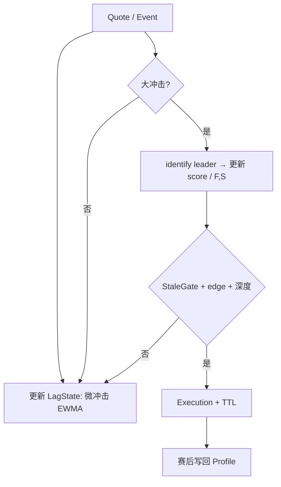

# 预测市场 × 赔率市场：延迟套利与赛中实时滞后判定

本文描述 **同一赛事** 在预测市场（PM）与赔率/滚球市场（Book）之间，因 ** repricing 速度不同** 产生的可交易窗口。核心原则：

1. **不假设「永远是 PM 慢」**——对每场比赛在 **进行中持续估计** 当前谁领先、谁滞后。
2. **先判定滞后关系，再 ARM 套利**——未通过 `StaleGate` 不下单。
3. 延迟套利属于 **高竞争、高单边风险** 策略；下文给出工程化压风险方式，不构成投资建议或合规建议。

---

## 1. 术语与目标

| 符号 | 含义 |
|------|------|
| **F（Fast）** | 当前窗口内 **先完成定价** 的一侧 |
| **S（Slow）** | **尚未跟上** F 所隐含 fair 的一侧 |
| **t₀** | 冲击起点（事件时刻或 F 首次显著跳变） |
| **ARM** | 通过全部滞后与 edge 条件，允许执行引擎下单 |
| **category** | 离线统计用的类别键（联赛 × 阶段 × 盘型 × 事件类型等） |

**目标 payoff：** 在 S 上成交 **相对 F 仍错位的报价**，在 F（或等价腿）上 **对冲**，赚取价差而非方向性押注。

---

## 2. 总体流程

```text
开赛前：CategoryResolver + 离线 LagProfile（先验）
        ↓
赛中：  多源报价对齐 → 实时 LagState（谁快谁慢）
        ↓
冲击：  JumpDetector → StaleGate →（可选）FairValue → Execution
        ↓
赛后：  样本写回 LagProfile + 本场 LagState 归档
```

---

## 3. 比赛类别（Category）与离线先验

### 3.1 Category 维度

| 维度 | 示例 | 说明 |
|------|------|------|
| sport | soccer, basketball | |
| league | EPL, UCL, NBA | |
| phase | pre, inplay_h1, inplay_h2, ot | 赛中 phase 随时钟更新 |
| pm_contract | binary_win, advance, total_equiv | 与 Book 映射 |
| book_type | sharp_inplay, soft_inplay, exchange | F 的候选池 |
| event_type | goal, red_card, pen_awarded, var_overturn | **分事件标定** |

**category_key** 示例：`soccer|EPL|inplay|goal|pm_binary_win|book_sharp`

### 3.2 离线 LagProfile（先验）

对历史事件回放，在 `[t₀, t₀ + T_max]`（建议 T_max = 120s）内计算：

| 字段 | 定义 |
|------|------|
| `P(S=book lags)` | Book 为滞后的比例（PM 先动） |
| `P(S=pm lags)` | PM 为滞后的比例 |
| `delta_t_p50`, `delta_t_p90` | 慢侧追上 fast fair 的滞后秒数 |
| `edge_at_5s`, `edge_at_10s` | 冲击后固定时刻扣费前价差（bps） |
| `edge_half_life_sec` | 价差衰减到一半的时间 |

**默认角色（仅作开赛前初值）：**

```text
若 P(S=pm lags) ≥ 0.65 且 median(Δt) ≥ 3s → prior: F=book, S=pm
若 P(S=book lags) ≥ 0.65 → prior: F=pm, S=book
否则 → prior: neutral（完全依赖赛中 LagState）
```

### 3.3 LagProfile 配置示例

```yaml
category_key: "soccer|EPL|inplay|goal|pm_binary_win|book_sharp"
prior_fast: book_sharp
prior_slow: polymarket
P_pm_lags: 0.72
delta_t_p50_sec: 8
delta_t_p90_sec: 28
min_edge_bps: 120
jump_theta_book: 0.025    # 2.5% 隐含概率
jump_theta_pm: 0.020
stale_epsilon: 0.015
max_hold_sec: 45
```

---

## 4. 赛中实时滞后判定（核心）

离线 profile 只提供 **先验**；**同一场比赛** 内 PM 与 Book 的相对速度会因流动性、机器人、Indexer 延迟而变化。因此需要在 **整场比赛** 中维护滚动状态 `LagState(match_id)`，并在 **每次冲击** 时用最新状态参与 `StaleGate`。

### 4.1 统一隐含概率

| 来源 | 转换 |
|------|------|
| PM YES | `p = mid(yes_bid, yes_ask)`，吃单用 ask/bid |
| Book decimal（二元） | `p_raw = 1/decimal`；三项盘用归一化去 overround 得 fair 向量 |
| 时间戳 | 每条 quote：`exchange_ts`, `ingest_ts`；决策用 `ingest_ts` 并记录 **源延迟** |

**Pre-event 基准：** 滚动窗口 `W_pre = 30s` 的 VWAP，记 `p_F_pre`, `p_S_pre`（F/S 由当前 LagState 角色分配，见下）。

### 4.2 LagState 数据结构

```yaml
match_id: "..."
prior_fast: book
prior_slow: pm
# 赛中实时估计（每 1s 或每次 quote 更新）
score_fast: 0.0          # 正 → book 更像 Fast
score_slow: 0.0
role_fast: book          # 当前采纳的 F
role_slow: pm            # 当前采纳的 S
confidence: 0.0          # 0..1，低于阈值则 neutral
last_shock_id: null
samples_in_match: 0
micro_shocks: []         # 本场小冲击列表（见 4.4）
```

**角色切换规则（保守）：**

```text
若 confidence ≥ 0.6：
  F = role_fast, S = role_slow
若 confidence < 0.6：
  neutral：仅记录冲击，不 ARM；或使用 prior_fast/prior_slow 但 edge_min 加倍
```

### 4.3 实时得分：无事件时的「微冲击」

大事件（进球）较少，但滚球盘 **持续微调**。用 **微冲击** 在赛中积累「谁经常先动」：

**检测（对每个 canonical outcome，如主胜）：**

1. 在 `Δt_win = 2s` 内，Book 的 `|Δp_book| ≥ θ_micro_book` **或** PM 的 `|Δp_pm| ≥ θ_micro_pm`（θ 低于进球阈值，如 0.008）。
2. 判定 **谁先达到** `|Δp| ≥ θ_micro` 的 80%：
   - Book 先 → `micro_delta = +1`（book 更快）
   - PM 先 → `micro_delta = -1`
   - 同时（Δt < 200ms）→ `0`，丢弃

**EWMA 更新（每场独立）：**

```text
score_fast += w_event * micro_delta
score_slow -= w_event * micro_delta

w_event = 1.0   # 微冲击
w_event = 3.0   # 大冲击（JumpDetector 确认）
```

**confidence（本场）：**

```text
confidence = min(1.0, |score_fast| / (3 + samples_in_match^0.5))
role_fast = book  if score_fast > 0 else pm
role_slow  = pm   if score_fast > 0 else book
```

可选：用 **最近 15 分钟** 的 micro 样本数作为 `samples_in_match` 的下限，避免上半场 0:0 无样本。

### 4.4 大冲击时的滞后判定（与 ARM 衔接）

当 **JumpDetector** 触发（Book 或 PM 出现 `θ_jump`，或事件 feed 与价格同向）：

**Step 1 — 识别冲击领先方（与 profile 无关）：**

```text
t_book_jump = first t where |p_book(t) - p_book_pre| ≥ θ_jump_book
t_pm_jump   = first t where |p_pm(t)   - p_pm_pre|   ≥ θ_jump_pm

若仅一侧达到 → leader = 该侧
若两侧都达到：
  leader = argmin(t_book_jump, t_pm_jump)
  lag_sec = |t_book_jump - t_pm_jump|
```

**Step 2 — 更新 LagState：**

```text
若 leader == book → score_fast += 3; role_fast=book; role_slow=pm
若 leader == pm   → score_fast -= 3; role_fast=pm; role_slow=book
samples_in_match += 1
```

**Step 3 — 当前是否「S 仍 stale」（ARM 必要条件）：**

设当前 F=role_fast 对应价格 `p_F`，S=role_slow 对应 `p_S`：

```text
F_repriced = |p_F - p_F_pre| ≥ θ_jump_F
S_stale    = |p_S - p_S_pre| < ε_stale
aligned    = sign(p_F - p_F_pre) 与冲击方向一致（有 feed 时）

ARM_stale  = F_repriced AND S_stale AND aligned
```

**Step 4 — 与先验一致性（软约束）：**

```text
若 leader 与 prior_fast 相反 且 confidence < 0.4：
  允许 ARM，但 min_edge_bps *= 1.5
若 leader 与 prior_fast 相反 且 confidence ≥ 0.4：
  信任赛中 LagState，prior 仅作日志
```

### 4.5 赛中 LagState 输出示例（日志/监控）

| 时刻 | 比分 | score_fast | confidence | F | S | 说明 |
|------|------|------------|------------|---|---|------|
| 12' | 0-0 | +2.1 | 0.45 | book | pm | 微冲击累积 |
| 34' | 1-0 | +5.4 | 0.78 | book | pm | 进球 book 先跳 6s |
| 34' +8s | 1-0 | +5.4 | 0.78 | — | — | StaleGate PASS → ARM |

---

## 5. StaleGate 与 Fair Value

### 5.1 ARM 布尔条件（全部满足）

| # | 条件 |
|---|------|
| 1 | `LagState.confidence ≥ conf_min` 或（neutral 时 `edge ≥ 2× min_edge`） |
| 2 | `ARM_stale`（§4.4 Step 3） |
| 3 | `edge = edge_buy(S, p_fair) ≥ min_edge_bps(category, match)` |
| 4 | S 可成交量 ≥ `min_notional`；F 对冲容量 ≥ 计划 size |
| 5 | 赛前 `settlement_hash` 与映射 OK |
| 6 | `ingest_lag(S) < lag_max_ms`（避免用 stale 索引假阳性） |

**p_fair：** 优先 F 在冲击后 `3s VWAP`；Book 为三项时用与 PM 合约一致的 marginal fair。

### 5.2 费用与 buffer

```text
edge_net = edge_gross - fee_pm - fee_book - slippage_buffer(category)
slippage_buffer 建议 ≥ 历史 edge_half_life 内衰减的 p75
```

---

## 6. 执行

### 6.1 腿序

| 场景 | 腿序 |
|------|------|
| 默认（S=PM 薄、窗口短） | F 小单锁定 fair → S 限价/IOC |
| edge 极大且 Δt 仍 < p50 | S IOC → 立即 F 对冲 |
| neutral + 高 edge | 仅 F 可成交时做；否则 skip |

### 6.2 超时与撤单

- 限价单 TTL = `min(LagProfile.delta_t_p50, max_hold_sec)`
- 部分成交：未对冲名义 **立即** 在 F 补平或进入 manual
- Kill：单场对冲失败率 > 阈值 → 本场停止 ARM

### 6.3 追价子模式

仅在 **S 已开始动** 但 `|p_S - p_F| ≥ edge_min` 且 `t - t₀ < delta_t_p50`：

- 限价上限：`p_fair - min_edge`，禁止超过 fair

---

## 7. 数据与系统模块

| 模块 | 职责 |
|------|------|
| **CategoryResolver** | 开赛前绑定 category、settlement、PM↔Book 映射 |
| **LagProfileStore** | 离线表 + 按 category 滚动更新 |
| **StreamAligner** | 多源 p(t)、ingest 延迟监控 |
| **LagStateEngine** | §4 微冲击 + 大冲击，每秒/每 tick 更新 |
| **JumpDetector** | θ_jump、feed 校验 |
| **StaleGate** | ARM 条件 |
| **FairValueEngine** | F 的 fair、vig 处理 |
| **ExecutionOrchestrator** | 腿序、TTL、部分成交 |
| **PostTradeAnalyzer** | 实现 edge、写回 LagProfile 与 LagState 样本 |

### 7.1 实时循环（伪代码）

```python
def on_quote(match_id, venue, p, ts):
    aligner.update(match_id, venue, p, ts)
    lag = lag_state[match_id]
    if detect_micro_shock(match_id):
        lag.update_from_micro(...)
    if detect_jump(match_id):
        leader, lag_sec = identify_leader(match_id)
        lag.update_from_shock(leader)
        if stale_gate(match_id, lag):
            arm_execution(match_id, lag)

def on_match_tick(match_id, clock):
    # 可选：phase 变更时重置 micro 窗口权重，不重置 score（保留本场记忆）
    pass
```

---

## 8. 风控摘要

| 风险 | 措施 |
|------|------|
| 秒级竞争 | 只做 `delta_t_p50 ≥ 3s` 的 category；低 ingest 延迟 |
| 单边 | 腿序 + max_hold + 禁止仅 S 裸奔 |
| 角色误判 | 微冲击 + 大冲击联合；confidence 低时加价或 skip |
| 规则不一致 | settlement 白名单 |
| 假跳变 | 持续 1s 或 feed 同向确认 |

---

## 9. 上线阶段

1. **回放标定**：输出各 category 的 LagProfile 与「neutral 占比」。
2. **赛中 shadow**：只写 LagState + ARM 信号，不下单。
3. **小流量 live**：单 category（如大联赛进球 + PM 二元胜）。
4. **扩事件/联赛**：每扩一类重新验收 LagProfile。

---

## 10. 决策流程图



---

## 11. 附录：映射与结算检查（开赛前必过）

| 检查项 | Book | PM |
|--------|------|-----|
| 常规时间 vs 加时 | | |
| 退赛/腰斩 | void 规则 | |
| 数据来源 | | UMA / 官方 |
| 二元 vs 1X2 | 映射方程存档 | |

---

*文档版本：v1 — 赛中实时 LagState + StaleGate ARM*
