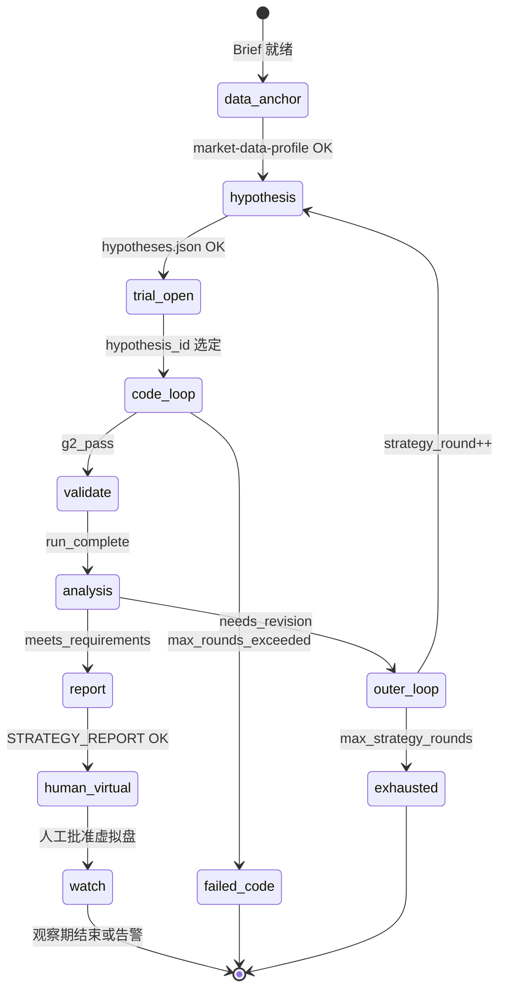

# 量化研究平台 — Agent 层设计（Skill 清单）

> **范围：** 仅 **Agent / Skill** 层，对应「固件 + 插件 + 多 Agent」架构中的 **Agent 层**。  
> **固件**（回测、门槛 G1–G8、试验登记）由确定性 Python 实现，**不由 AI 执行**。  
> **约定：** 每个 Skill 以 **`/slash-command`** 暴露；配套 **`SKILL.md`（角色与工具）**、**步骤契约（manifest 描述 + 校验脚本）**、**标准交付路径**，便于编排与审计。  
> **Loop Skill：** **`/strategy-code-loop`**（写码 ↔ 审查）、**`/strategy-backtest-analysis-loop`**（回测不达标 → 新一轮假设文档 → 再走 code-loop → 回测 → 分析）。Loop 只 **按规则 invoke 原子 Skill** 并汇总 manifest；原子 Skill 仍保留单轮契约，便于调试与 CI。  
> **交易 / 实盘 Agent 层**（部署、信号、执行、**实盘风控**）见 [`quant-platform-live-agents.md`](./quant-platform-live-agents.md)。

**日期：** 2026-10-22  
**关联：** 《量化研究平台架构设计：固件 + 插件 + 多 Agent 协作》（2026-10-20）

---

## 0. 系统定位：挖掘 · 分析 · 回测 · 优化

本文档描述 **全自动 AI 策略智能体** 的 Skill 层：从任务入口到可审计交付物，**不**替代固件（回测引擎、G1–G8 门槛、Trial Log）。

| 能力 | 含义 | 主要 Skill | 固件参与 |
|------|------|------------|----------|
| **策略挖掘** | 在 Brief 约束下提出 **可检验方向**（假设 MD），查因子库与历史 trial **去重** | `/factor-mining`（因子库）、`/strategy-hypothesis` | Trial Log 只读查询 |
| **策略实现** | 将假设写成 **插件代码**，并通过 **G2 审查** | `/strategy-code`、`/strategy-review`、`/strategy-code-loop` | G1 注册中心静态检查 |
| **策略回测** | 按文档从 **数据中心** 取数，**确定性**执行插件与检验项 | `/strategy-validate-run` | Engine、Validation、`gate.judge`（G3–G8） |
| **策略分析** | 解读 metrics / Gate / Brief，写 **回测数据分析结果**，判断是否达标 | `/strategy-backtest-analysis` | 仅读 `gate.json`，不推翻 |
| **策略优化** | 不达标时 **自动迭代**：内环改代码；外环 **新策略文档** 再回测 | `/strategy-code-loop`（实现层）、`/strategy-backtest-analysis-loop`（方向层） | 参数扰动等见 G6（固件 validate） |
| **对外交付** | 汇总 trial 链与 Brief 对照的 **标准研究报告**（HTML/PDF） | `/strategy-report` | 可选固件 `report.render` 模板 |
| **研究风控** | G2 通过后、回测前：**策略风险**审查（敞口逻辑、Brief forbidden、集中度等） | `/strategy-risk-control` | 固件 **`research.risk.check`** 静态规则 |

**风控三层（研究侧，勿与 G3–G8 / 实盘 L1–L5 混淆）：**

| 层 | 是什么 | Skill / 固件 |
|----|--------|----------------|
| **正确性审查** | 未来函数、文档与代码一致 | `/strategy-review`（G2） |
| **研究风控 Skill** | 风险设计是否可接受（杠杆、集中度、尾部暴露 **设计**） | **`/strategy-risk-control`** |
| **回测门槛** | 样本外、Sharpe 等 **历史统计** | 固件 **G3–G8**（validate-run） |

**两层优化（避免混用）：**

| 优化类型 | 何时 | 走哪条路径 | 策略 MD 是否变更 |
|----------|------|------------|------------------|
| **实现优化** | 假设仍成立；分析 **`recommended_next: strategy-code-loop`** | 同一假设小节 → **`/strategy-code-loop`** | **否** |
| **方向优化** | 需换思路/family；分析 **`handoff → strategy-backtest-analysis-loop`** | **#2 → #5 → #6 风控 → #7 → #8** | **是** |
| **参数优化** | 假设不变，仅调整插件 **`params`**（在 metadata **`param_ranges`** 内） | **`/strategy-code-loop`** → #6 风控 → #7/#8；**不**单独设「调参 Agent」 | 否（除非改假设 MD） |

**参数与 G6：** 参数变更写在插件 metadata 的 `params`；固件 **`validation.validate`** 做 **`param_ranges` 扰动**（G6）。Agent **禁止**在 validate-run 之后手改 params 凑门槛；须走 code-loop 升版本并 re-review。

**Agent 与 G1–G8（摘要）：** G1/G2 在进回测前由 Registry + review loop 保证；G3–G8 **仅** validate-run 触发的固件判定，由 backtest-analysis **解释**。**虚拟盘/实盘、Token 预算** 在 Agent 层外或 `/quant-orchestrate` 约束。

---

## 1. 入口：研究任务长什么样

全自动闭环的 **唯一业务入口** 建议固定为 **`STRATEGY_BRIEF.md`**，由人或上游系统写入；**协调 Agent** 只读该文件启动任务。

| 字段 | 示例（加密货币 · BTC 现货） | 示例（A 股方向） |
|------|-----------------------------|------------------|
| `market` | `crypto_spot` | `cn_equity` |
| `universe` | `BTC/USDT`（可扩展多币） | `CSI300` / 自选股票池 |
| `freq` | `1m`（存储）→ 策略可用 `15m`/`1h` | `1d` |
| `objective` | 现货多头/空仓或 0–1 仓位 | 多空或 T+1 约束下多头 |
| `target_ann_return` | `0.20`（年化 20%，研究目标非承诺） | 同上或团队自定 |
| `max_drawdown` | `0.10`（最大回撤 10%） | `0.15` |
| `horizon` | 回测区间、样本外比例 | 同上 |
| `cost_assumption` | 现货 taker 费 + 滑点 bps | 佣金 + 印花税 + 滑点 |
| `forbidden` | 永续、杠杆、lookahead | 涨跌停违规、ST 等 |
| `research_gate_only` | 可选 `true`：达标仅看 Gate，不看 Brief 收益/回撤 | 默认 `false`，见 §13 |
| `virtual_paper_watch_days` | 可选；虚拟盘批准后观察天数 | 配合 `/virtual-paper-watch` |

**说明：** `target_ann_return` / `max_drawdown` 写入 **Brief**，供 **假设生成** 与 **报告解读**；**是否通过** 仍只由固件 **`gate.judge()`（G3–G8）** 判定，Agent **不能**改门槛或替裁判签字。

可选字段（与数据中心绑定）：

| 字段 | 说明 |
|------|------|
| `dataset_id` | 数据中心内已发布的数据集 ID（如 `ohlcv.crypto_spot.1m`）；Brief 可显式指定 |
| `snapshot_id` | 固定某次发布快照；省略则由 `/market-data-profile` 或编排器选用 **当前研究默认可用快照** |

---

## 2. 数据中心（唯一数据来源）

行情、因子及研究用另类数据 **统一由团队数据中心** 采集、清洗、质检并 **发布快照**。研究平台固件的数据层只读数据中心（或与其同步的本地 Parquet 镜像），**不是** Agent 去交易所或公网「找数据」。

| 层级 | 谁负责 | Agent 能做什么 |
|------|--------|----------------|
| **入库与更新** | 数据工程 / 数据中心 pipeline | **不能** 拉数、改库、触发全量下载 |
| **目录与快照** | 数据中心发布 `dataset_id` + `snapshot_id` | 只读：**查询目录、绑定 Brief、写入说明文档** |
| **回测读取** | 固件 `data.load(..., snapshot_id=...)` | 通过 Tool API **调用**，不直连存储 |

建议在 `config/datacenter.yaml`（无密钥）中配置：服务地址或镜像根路径、默认 `datacenter` 环境名、各 `market` 对应的默认可用 `dataset_id` 策略。密钥与内网认证走环境变量，不出现在仓库与 Agent 上下文中。

**`/market-data-profile` 的定位：** 不是「发现新数据源」，而是 **把本次研究任务锚定到数据中心里已有、且质检通过的数据集与快照**，并生成人类可读的 `MARKET_DATA_PROFILE.md`（字段、覆盖区间、PIT 语义、已知缺口）。若 Brief 要求的 `universe` / 字段在目录中不存在，交接给协调 Agent 归类为 **数据问题**，等待数据中心补数或换 Brief，**不由** 研究 Agent 自行换源或联网补齐。

---

## 3. 与「量化 AI 智能体」常见架构的对齐（2024–2026 实践）

业界与工业界常见做法与本平台设计一致，可按下表映射：

| 趋势 | 本平台落点 | Agent 是否参与 |
|------|------------|----------------|
| **生成 vs 执行分离** | 策略代码由 Agent 写；回测/指标由 **Engine + Validation** 算 | Agent 只 **调用** Tool API，不手算净值 |
| **多角色 + 审查隔离** | 写代码（Research）与审代码（Review）**分上下文、闭环迭代**；Reviewer 建议 **异模型** | 是 |
| **工具边界（Tool API）** | 仅允许：读 **数据中心目录/快照元数据**、提交插件、跑回测、查 Trial Log、出报告 | 是 |
| **结构化交接（handoff JSON）** | 每步 `*.manifest.result.json` + 统一 `handoff` 块 | 是 |
| **可复现** | 每次 Trial 绑定 **data_snapshot_id**、插件 version、params | Agent 记录，固件强制执行 |
| **防过拟合** | G4–G8 + 策略族试验次数 + Deflated Sharpe | **仅固件**；Agent 只解释失败类别 |
| **编排器** | Orchestrator 状态机 + Token/族上限 | 是（Phase 0 可用纯脚本编排） |

与常见「Alpha 挖掘 Agent」的差异（刻意设计）：  
不把「回测好不好」交给 LLM 投票；LLM 负责 **假设、代码、解释、下一版方向**，**Gate** 负责 **通过/淘汰**。

---

## 4. Skill 总览（建议实现的 Agent）

下列每一行对应一个 **`/slash-command`**。建议目录：

`quant-platform/agents/<skill-name>/SKILL.md`  
`quant-platform/contracts/<skill-name>.manifest.desc`  
`quant-platform/contracts/<skill-name>.validate.sh`  
`quant-platform/contracts/<skill-name>.invoke.example.sh`（可选：本地/CI 触发示例）

| # | Skill 名 | 命令 | 推荐模型 | 管什么（职责） | 主要输出 | 可调 Tool API | 禁止 |
|---|----------|------|----------|----------------|----------|---------------|------|
| 0 | **任务协调** | `/quant-orchestrate` | 编排可用规则引擎；复杂分支可用 Claude | 读 Brief；**从 `hypotheses.json` 选定 `hypothesis_id` 开 trial**；派单与 **失败路由**（§5.1）；Token / **family 上限** | `runs/<run_id>/orchestrator.log`、`handoff.json` | 查 Trial Log、查快照、触发 skill | 写代码、改 gate、改数据中心 |
| 1 | **市场数据锚点** | `/market-data-profile` | 以规则/脚本为主；缺口语化说明时用 Claude | **策略发现前**：在 **数据中心目录** 中绑定 `dataset_id` + `snapshot_id`；写清字段、区间、PIT、缺口 | `data/MARKET_DATA_PROFILE.md` + `data/market-data.manifest.result.json` | `datacenter.list_datasets()`、`datacenter.describe()`、`data.snapshot_info()` | 联网拉数、写数据中心、跑回测、写策略 |
| 2 | **假设与方向挖掘** | `/strategy-hypothesis` | Claude | 写 **策略方向 MD** + `hypotheses.json`；**必读** 研究历史去重（§6）+ **`factor_library`（§6 因子库）**；新假设须引用所用因子及与历史差异 | 见 §6 + manifest | `trial_log.query`、`factor_library.query/read`、读 MARKET_DATA_PROFILE | 提交插件、跑回测、写因子库 |
| 3 | **策略代码（单轮）** | `/strategy-code` | Claude Agent SDK | **单轮**：编写或修订 Strategy 插件 `.py` + `IMPLEMENTATION_NOTES.md`；由 **`/strategy-code-loop` 反复调用** | `strategy-code.manifest.result.json` + 插件路径 | 读假设 MD、schema、**submit_plugin_draft**、静态检查/单测 | **run_backtest**、读 gate 阈值、直连数据中心 |
| 4 | **代码审查（单轮）** | `/strategy-review` | **与 Code 不同模型** | **单轮**：输入 = 代码 + 策略文档；输出 `approved` / `rejected` + `issues[]` | `review.manifest.result.json`（含 `inputs_reviewed`） | 静态分析、读 `.py`、读策略 MD | 改代码、改策略文档 |
| 5 | **策略代码审查闭环** | `/strategy-code-loop` | **编排优先**（Shell/Python；可选轻量 LLM 只做失败摘要） | **Loop Skill**：按轮次调用 `/strategy-code` → `/strategy-review`，直到 **G2 通过** 或 **`max_review_rounds`**；汇总全程 manifest | `strategy-code-loop.manifest.result.json` + `runs/.../trials/<trial_id>/code-loop/` | **invoke** `/strategy-code`、`/strategy-review`；读上轮 `issues[]` | 代替子 Skill 写码/改结论、跑回测 |
| 6 | **研究风控（单轮）** | `/strategy-risk-control` | **与 Review 不同模型/会话** | G2 通过后：**策略风险**审查（Brief `forbidden`、仓位上界、集中度、是否缺止损/降杠杆 **设计说明**）；**不**替代 G3–G8 | `STRATEGY_RISK_REVIEW.md` + manifest（`approved`/`rejected`） | `research.risk.check`、读插件/假设 MD | 跑回测、改 gate、改 L1–L5 |
| 7 | **回测与验证执行** | `/strategy-validate-run` | **固件为主**（Agent 只触发 Tool API） | 依策略文档 + 插件元数据 **从数据中心 load** → **执行插件** → 产出 metrics / 检验项 / **gate.judge 结果**（不在此步做深度归因） | `trials/T-xxx/metrics.json` + `gate.json` + `strategy-validate-run.manifest.result.json` | `data.load`、`run_backtest`、`validate`、`trial_log` | 手算净值、改 gate、改插件、写分析 MD |
| 8 | **回测结果分析（单轮）** | `/strategy-backtest-analysis` | Claude | **单轮**：对照 Brief + Gate + 策略文档 + 代码判断是否满足；写入 **`BACKTEST_ANALYSIS.md`**；由 **backtest-analysis-loop** 在每轮试验末调用 | `trials/T-xxx/BACKTEST_ANALYSIS.md` + manifest | 读 metrics/gate、读 Brief/假设 MD/NOTES | 改 gate/metrics、启动 loop |
| 9 | **策略研究外环闭环** | `/strategy-backtest-analysis-loop` | **编排优先**（Shell/Python） | **Loop Skill**：不达标时按轮 **#2 → #5 → #6 风控 → #7 回测 → #8 分析** | `strategy-backtest-analysis-loop.manifest.result.json` + `runs/.../backtest-loop/round-<n>/` | invoke #2、#5、#6、#7、#8 | 跳过假设重写、代替 Gate 判定 |
| 10 | **因子挖掘** | `/factor-mining` | Claude + 检索（**单独跑**） | 挖掘/整理因子定义，写入 **因子库** | `factor_library/…` + manifest | `factor_library.append`、检索 | 跑回测、写策略假设、改 Trial Log |
| 11 | **策略研究报告** | `/strategy-report` | Claude + 固件模板 | **`meets_requirements: true`** 后出报告 | `reports/<trial_id>/STRATEGY_REPORT.html` + manifest | `report.render` | 改 metrics/gate |
| 12 | **虚拟盘观察（可选）** | `/virtual-paper-watch` | 规则为主 | 虚拟盘 vs 回测偏离（轻量）；完整执行链见 live 文档 | `VIRTUAL_PAPER_WATCH.md` + manifest | `virtual_paper.metrics()` | 改虚拟盘、改回测结果 |

**与总体架构角色的对应关系：**

| 架构角色 | 上表 Skill |
|----------|------------|
| Orchestrator | `/quant-orchestrate` |
| Researcher | `/strategy-hypothesis` + **`/strategy-code-loop`** + **`/strategy-backtest-analysis-loop`** |
| Factor（独立任务） | **`/factor-mining`** → 因子库；**不**纳入 `/quant-orchestrate` 主链，除非 Brief 显式触发 |
| Reviewer | **`/strategy-review`**（由 loop 按轮调用） |
| Risk（研究） | **`/strategy-risk-control`**（G2 后、回测前；与 Review 分工） |
| Validator | **`/strategy-validate-run`**（执行试验）+ **`/strategy-backtest-analysis`**（解读是否达标；Gate 仍由固件判定） |
| Reporting | **`/strategy-report`**；上线后可选 **`/virtual-paper-watch`** |

---

## 5. 推荐调用顺序（全自动挖掘一条策略）

```text
（独立任务，可先于或与研究并行）
    /factor-mining  →  factor_library/     # 因子挖掘 Skill；写入因子库，供 #2 引用

STRATEGY_BRIEF.md
    → /market-data-profile          # 绑定数据中心 dataset + snapshot（下游只读该快照）
    → /strategy-hypothesis          # 因子库 + 历史 trial 去重 → 第 1 轮策略文档（round-1）
    → /quant-orchestrate            # 选定 hypothesis_id，开 trial_id
         ├→ /strategy-code-loop           # #5：内含 #3 code、#4 review
         ├→ /strategy-risk-control        # #6：研究风控；reject → 回 #5
         ├→ /strategy-validate-run        # #7
         ├→ /strategy-backtest-analysis   # #8
         │     ├→ meets_requirements → /strategy-report → 人工闸门（虚拟盘）→ 可选 /virtual-paper-watch
         │     └→ 不满足 → /strategy-backtest-analysis-loop
         │              每轮：#2 → #5 → #6 风控 → #7 → #8，直到达标或 max_strategy_rounds
         └→ family 达上限 → 汇总终止
```

### 5.1 协调器失败路由（`/quant-orchestrate`）

| 类型 | 识别依据 | 下一步（自动） | 是否计 G8 试验 |
|------|----------|----------------|----------------|
| **代码错误** | code-loop `max_rounds_exceeded`、Registry/G1 失败 | 终止本 trial 或转人工；**不**进 risk-control / validate-run | 否 |
| **研究风控拒绝** | `/strategy-risk-control` **`decision: rejected`** | 回 **`/strategy-code-loop`**（同 trial）；manifest 记录 `risk_issues[]` | 否 |
| **数据问题** | 缺 snapshot 字段、质检失败、`data.load` 报错 | 标记等待数据中心；**不**换源 | 否 |
| **策略无效** | 已回测；`meets_requirements: false` 或 gate 淘汰 | **`/strategy-backtest-analysis-loop`** 或按分析 `recommended_next` 走 **方向/实现优化**（§0） | 是（每次完整 validate-run） |

**假设选题：** `#2` 产出 1–3 条假设后，由 **`/quant-orchestrate`**（规则优先）读取 `hypotheses.json` 的 `rank` / `recommended_hypothesis_id` 绑定首个 trial；后续 trial 可换 `hypothesis_id` 仍属同一 `run_id`。

**Phase 0（MVP）：** **`/strategy-code` + `/strategy-review` + `/strategy-code-loop`** + 脚本 orchestrator；假设 MD 可 **人工给定**，先跑通 G2 → 回测 → 分析。

**Phase 1（全自动主链）：** **`/market-data-profile`**、**`/strategy-hypothesis`**、**`/strategy-risk-control`**、**`/strategy-validate-run`**、**`/strategy-backtest-analysis`**、**`/strategy-backtest-analysis-loop`**、完整 **`/quant-orchestrate`**。

**Phase 2（增强挖掘）：** **`/factor-mining`** 与 **`factor_library/`**；`dedup_check` / `factor_refs` 的 validate 硬约束。

**Phase 3（交付与上线）：** **`/strategy-report`**；可选 **`/virtual-paper-watch`**；固件 **`core/tool_api/`** 与本文 §12 对齐。

---

## 6. 步骤契约（每个 Skill 必须具备）

每个 Skill 除 `SKILL.md` 外，建议固定四类工程产物，保证编排器与 CI 能自动验收：

| 产物 | 路径模式 | 作用 |
|------|----------|------|
| Skill 定义 | `agents/<name>/SKILL.md` | YAML frontmatter：`name`, `description`, `allowed-tools`, `argument-hint` |
| 契约说明 | `contracts/<name>.manifest.desc` | Agent 入口说明、Example JSON、**result 门**（成功/失败必填字段） |
| 校验脚本 | `contracts/<name>.validate.sh` | 检查交付路径、JSON 字段、禁止臆造路径或伪造 gate 结果 |
| 触发示例 | `contracts/<name>.invoke.example.sh` | 文档化如何带 `DELIVERY:` 等参数调用该命令（团队自选 CLI/SDK） |

**步骤结果 JSON 建议字段（写入各步 `*.manifest.result.json`）：**

```json
{
  "step": "strategy-code",
  "result": "success",
  "run_id": "R-20261022-001",
  "trial_id": "T-20261022-0042",
  "strategy_brief": "STRATEGY_BRIEF.md",
  "market_data_anchor": {
    "datacenter": "prod",
    "dataset_id": "ohlcv.crypto_spot.1m",
    "snapshot_id": "snap-20261021-crypto-spot-1m",
    "profile": "data/MARKET_DATA_PROFILE.md"
  },
  "plugin": {
    "name": "dual_ma_trend",
    "version": "1.0.2",
    "path": "plugins/strategies/dual_ma_trend_v1.0.2.py",
    "family": "trend_following"
  },
  "hypothesis_id": "H1",
  "review_inputs": {
    "plugin_path": "plugins/strategies/dual_ma_trend_v1.0.2.py",
    "strategy_hypothesis_md": "runs/R-20261022-001/STRATEGY_HYPOTHESIS.md",
    "hypothesis_section_anchor": "H1",
    "implementation_notes_md": "runs/R-20261022-001/trials/T-20261022-0042/IMPLEMENTATION_NOTES.md"
  },
  "handoff": {
    "from": "strategy-code",
    "to": "strategy-review",
    "status": "ready_for_review"
  },
  "review_round": 1
}
```

**`/strategy-review` 的必选输入（编排器打包传入，缺一项则不得开审）：**

| 输入 | 路径 / 说明 |
|------|-------------|
| **策略插件代码** | `plugins/strategies/<name>_v*.py` |
| **策略方向文档** | `runs/<run_id>/STRATEGY_HYPOTHESIS.md` 中与本次 **`hypothesis_id`** 对应的小节（如 `### H1`） |
| **实现说明文档** | `runs/<run_id>/trials/<trial_id>/IMPLEMENTATION_NOTES.md` |

审查须 **三者对照**：经济逻辑以假设小节为准、实现取舍以 IMPLEMENTATION_NOTES 为准、仓位与数据用法以 **代码** 为准。issue 类型除 `lookahead` / `leakage` 外，应包含 **`doc_code_mismatch`**（文档与代码不一致）、**`hypothesis_drift`**（代码偏离假设小节且 NOTES 未解释）。

**审查退回后 Research 再次提交时**，manifest 应携带 `review_round`、`prior_review_path`（上一版 `review.manifest.result.json`）及 `issues_addressed[]`（逐条对应 Reviewer 的 `issues`）。

**Review 步骤 manifest 示例（`rejected` → 回到 `/strategy-code`）：**

```json
{
  "step": "strategy-review",
  "result": "success",
  "trial_id": "T-20261022-0042",
  "decision": "rejected",
  "review_round": 1,
  "inputs_reviewed": {
    "plugin_path": "plugins/strategies/dual_ma_trend_v1.0.2.py",
    "strategy_hypothesis_md": "runs/R-20261022-001/STRATEGY_HYPOTHESIS.md",
    "hypothesis_section_anchor": "H1",
    "implementation_notes_md": "runs/R-20261022-001/trials/T-20261022-0042/IMPLEMENTATION_NOTES.md"
  },
  "issues": [
    { "type": "lookahead", "line": 18, "detail": "使用了当日收盘价决定当日仓位" }
  ],
  "handoff": {
    "from": "strategy-review",
    "to": "strategy-code-loop",
    "status": "revise_plugin"
  }
}
```

**`decision: approved` 时**（在 **loop 内**）：单轮 Review 的 `handoff` 仍指向 `strategy-code-loop`；由 **Loop Skill** 结束循环并产出总 manifest。**G2 通过** 以 **`/strategy-code-loop` 的 `outcome: g2_pass`** 为准；此后 **`/strategy-risk-control` → `/strategy-validate-run`**。

**`/strategy-code-loop` 步骤 manifest 示例：**

```json
{
  "step": "strategy-code-loop",
  "result": "success",
  "run_id": "R-20261022-001",
  "trial_id": "T-20261022-0042",
  "hypothesis_id": "H1",
  "max_review_rounds": 3,
  "review_rounds_used": 2,
  "outcome": "g2_pass",
  "final_plugin": {
    "path": "plugins/strategies/dual_ma_trend_v1.0.2.py",
    "version": "1.0.2"
  },
  "rounds": [
    {
      "round": 1,
      "code_manifest": "runs/R-20261022-001/trials/T-20261022-0042/code-loop/round-1/strategy-code.manifest.result.json",
      "review_manifest": "runs/.../round-1/review.manifest.result.json",
      "decision": "rejected"
    },
    {
      "round": 2,
      "code_manifest": "runs/.../round-2/strategy-code.manifest.result.json",
      "review_manifest": "runs/.../round-2/review.manifest.result.json",
      "decision": "approved"
    }
  ],
  "handoff": {
    "from": "strategy-code-loop",
    "to": "strategy-risk-control",
    "status": "g2_passed"
  }
}
```

（G2 通过后固定顺序：**#6 risk-control → #7 validate-run → #8 backtest-analysis**；不达标则 **`/strategy-backtest-analysis-loop`** 从 **#2** 起再跑 **#5→#6→#7→#8**。）

**Loop Skill 约定：**

| 项 | 说明 |
|----|------|
| **谁调用原子 Skill** | 仅 **`/strategy-code-loop`**（及本地调试）应串联多轮；`/quant-orchestrate` **不**直接交替调用 code/review。 |
| **每轮落盘** | 每轮独立的 `strategy-code` / `strategy-review` manifest 存入 `trials/<trial_id>/code-loop/round-<n>/`，loop 总 manifest **必须**引用路径。 |
| **失败退出** | `outcome: max_rounds_exceeded` → 协调器归类 **代码错误**，转人工或终止 trial；**不**进入 validate-run。 |
| **契约** | Loop 本身也有 `contracts/strategy-code-loop.validate.sh`：校验轮次连续、最后一轮 `approved` 才允许 `g2_pass`。 |

### `/strategy-validate-run` 执行链（文档 → 数据 → 代码 → 结果）

本步是 **唯一** 在 G2 之后把「策略文档 + 插件代码」落到 **可复现实验** 的环节；**加载数据与执行回测均为固件确定性逻辑**，Agent 只通过 Tool API **触发**；**是否满足需求** 由下一步 **`/strategy-backtest-analysis`** 完成。

```text
输入（编排器打包）
  STRATEGY_BRIEF.md、market_data_anchor（snapshot_id / dataset_id）
  STRATEGY_HYPOTHESIS.md（本 trial 的 hypothesis 小节）
  IMPLEMENTATION_NOTES.md、final_plugin（code-loop 产出）
        ↓
① 解析数据需求（Agent 读文档 + 插件 metadata：symbols、fields、freq、horizon）
        ↓
② data.load(symbols, fields, start, end, freq, snapshot_id=…)  ← 数据中心接口，PIT
        ↓
③ engine.run(strategy=plugin, data=…, cost_model=…)  ← 调用 generate_positions，算成交/净值
        ↓
④ validation.validate(trial)  ← 样本外、滚动、扰动等（固件 + 检验插件）
        ↓
⑤ gate.judge(metrics)  ← G3–G8，只读规则
        ↓
⑥ trial_log.log(trial)  ← 只追加登记
        ↓
⑦ handoff → /strategy-backtest-analysis
        ↓
输出：metrics.json、gate.json
```

| 阶段 | 谁执行 | 说明 |
|------|--------|------|
| 对齐文档与插件 | Agent（读） | `data_needed` / `universe` 须与 **假设 MD + 插件声明** 一致；与 `MARKET_DATA_PROFILE` / snapshot 冲突则 **数据问题**，不硬跑。 |
| 加载行情 | **固件 Data + 数据中心** | 只读已发布 snapshot；禁止 Agent 换源或自拼 CSV。 |
| 运行策略代码 | **固件 Engine** | 加载 Registry 已通过的插件版本；**不是** Agent 在 REPL 里 exec 策略。 |
| 指标与 Gate | **固件** | Agent manifest 必须 **引用** `gate.judge` 输出，不得编造 sharpe、通过率等。 |
| 报告解读 | **`/strategy-backtest-analysis`** | 本步 **不** 在 validate-run 做深度解读；分析 Skill 写 `BACKTEST_ANALYSIS.md`。 |

**`/strategy-validate-run` manifest 示例：**

```json
{
  "step": "strategy-validate-run",
  "result": "success",
  "trial_id": "T-20261022-0042",
  "run_inputs": {
    "strategy_brief": "STRATEGY_BRIEF.md",
    "strategy_hypothesis_md": "runs/R-20261022-001/STRATEGY_HYPOTHESIS.md",
    "hypothesis_section_anchor": "H1",
    "implementation_notes_md": "runs/R-20261022-001/trials/T-20261022-0042/IMPLEMENTATION_NOTES.md",
    "plugin_path": "plugins/strategies/dual_ma_trend_v1.0.2.py"
  },
  "market_data_anchor": {
    "datacenter": "prod",
    "dataset_id": "ohlcv.crypto_spot.1m",
    "snapshot_id": "snap-20261021-crypto-spot-1m"
  },
  "data_load": {
    "symbols": ["BTC/USDT"],
    "fields": ["open", "high", "low", "close", "volume"],
    "freq": "15m",
    "start": "2024-01-01",
    "end": "2026-10-01"
  },
  "deliverables": {
    "metrics_json": "trials/T-20261022-0042/metrics.json",
    "gate_json": "trials/T-20261022-0042/gate.json"
  },
  "gate": {
    "passed": false,
    "failed_gates": ["G4"],
    "rules_version": "gates-2026-10-01"
  },
  "handoff": {
    "from": "strategy-validate-run",
    "to": "strategy-backtest-analysis",
    "status": "run_complete"
  }
}
```

**`/strategy-backtest-analysis` manifest 示例：**

```json
{
  "step": "strategy-backtest-analysis",
  "result": "success",
  "trial_id": "T-20261022-0042",
  "analysis_inputs": {
    "strategy_brief": "STRATEGY_BRIEF.md",
    "strategy_hypothesis_md": "runs/R-20261022-001/STRATEGY_HYPOTHESIS.md",
    "hypothesis_section_anchor": "H1",
    "implementation_notes_md": "runs/.../IMPLEMENTATION_NOTES.md",
    "plugin_path": "plugins/strategies/dual_ma_trend_v1.0.2.py",
    "metrics_json": "trials/T-20261022-0042/metrics.json",
    "gate_json": "trials/T-20261022-0042/gate.json"
  },
  "deliverables": {
    "backtest_analysis_md": "trials/T-20261022-0042/BACKTEST_ANALYSIS.md"
  },
  "meets_requirements": false,
  "gate_passed": false,
  "brief_targets_met": {
    "target_ann_return": false,
    "max_drawdown": true
  },
  "root_cause_tags": ["G4_sample_oos", "hypothesis_regime_mismatch"],
  "recommended_next": "strategy-backtest-analysis-loop",
  "handoff": {
    "from": "strategy-backtest-analysis",
    "to": "strategy-backtest-analysis-loop",
    "status": "needs_revision"
  }
}
```

**`meets_requirements: true` 时** `handoff.to` 为 **`strategy-report`**（报告完成后 → **`human_virtual_gate`**）；**不**进入 backtest-analysis-loop。达标语义见 **§13**。

**`/strategy-backtest-analysis-loop` manifest 示例：**

```json
{
  "step": "strategy-backtest-analysis-loop",
  "result": "success",
  "run_id": "R-20261022-001",
  "max_strategy_rounds": 5,
  "strategy_rounds_used": 2,
  "outcome": "requirements_met",
  "trigger_analysis": "trials/T-20261022-0042/BACKTEST_ANALYSIS.md",
  "rounds": [
    {
      "strategy_round": 2,
      "trial_id": "T-20261022-0048",
      "hypothesis_manifest": "runs/R-20261022-001/backtest-loop/round-2/strategy-hypothesis.manifest.result.json",
      "strategy_hypothesis_md": "runs/R-20261022-001/backtest-loop/round-2/STRATEGY_HYPOTHESIS.md",
      "code_loop_manifest": "runs/.../round-2/strategy-code-loop.manifest.result.json",
      "validate_run_manifest": "trials/T-20261022-0048/strategy-validate-run.manifest.result.json",
      "analysis_manifest": "trials/T-20261022-0048/strategy-backtest-analysis.manifest.result.json",
      "meets_requirements": false
    },
    {
      "strategy_round": 3,
      "trial_id": "T-20261022-0051",
      "strategy_hypothesis_md": "runs/R-20261022-001/backtest-loop/round-3/STRATEGY_HYPOTHESIS.md",
      "meets_requirements": true
    }
  ],
  "final_trial_id": "T-20261022-0051",
  "handoff": {
    "from": "strategy-backtest-analysis-loop",
    "to": "quant-orchestrate",
    "status": "requirements_met"
  }
}
```

**`meets_requirements` 定义：** `gate_passed === true` **且**（若 Brief 写了研究目标）Brief 中声明的目标在分析 MD 里 **有明确对照结论**；任一项未达标则为 `false`，**必须** 在 `BACKTEST_ANALYSIS.md` 中写清未满足 **哪一条**、**相对策略文档/代码/需求** 的可能原因，不得空泛「表现不佳」。

**数据锚点（跨 Skill）：** 后续 Skill 的 manifest **必须**携带 **`market_data_anchor` 对象**（含 `datacenter`、`dataset_id`、`snapshot_id`、profile 路径）。编排器在启动回测前校验：快照在数据中心目录中 **状态为可用**、与 Brief 的 `market` / `universe` / `freq` 一致。可另配 `contracts/market-anchor.validate.py` 做自动化检查。

**`/strategy-hypothesis` 步骤 manifest 额外字段示例：**

```json
{
  "step": "strategy-hypothesis",
  "result": "success",
  "run_id": "R-20261022-001",
  "strategy_brief": "STRATEGY_BRIEF.md",
  "market_data_anchor": { "datacenter": "prod", "dataset_id": "ohlcv.crypto_spot.1m", "snapshot_id": "snap-20261021-crypto-spot-1m" },
  "deliverables": {
    "strategy_hypothesis_md": "runs/R-20261022-001/STRATEGY_HYPOTHESIS.md",
    "hypotheses_json": "runs/R-20261022-001/hypotheses.json"
  },
  "hypothesis_count": 3,
  "recommended_hypothesis_id": "H1",
  "dedup_check": {
    "brief_fingerprint": "crypto_spot|BTC/USDT|target_ann=0.20",
    "trials_consulted": ["T-20261015-0012", "T-20261018-0033"],
    "runs_consulted": ["R-20261015-000", "R-20261018-002"],
    "families_seen": ["trend_following", "mean_reversion_spot"],
    "skipped_as_duplicate": ["H_candidate_ma_cross_v1"]
  },
  "factor_refs": [
    { "factor_id": "funding_carry", "path": "factor_library/funding_carry.md", "usage": "H2_rationale" }
  ]
}
```

### 研究历史与去重（`/strategy-hypothesis` 必读）

各步产物 **已按 Skill 写入固定路径**；假设挖掘 **不得凭空造方向**，须先检索 **同一研究意图**（Brief 的 `market` / `universe` / 目标约束，或同一 `family`）下是否试过类似逻辑，并在 MD 中写清 **与历史的差异**。

| 来源 Skill | 典型落盘位置 | 去重时关注什么 |
|------------|--------------|----------------|
| **`/strategy-hypothesis`** | `runs/<run_id>/STRATEGY_HYPOTHESIS.md`、`hypotheses.json`；外环 `backtest-loop/round-<n>/` 下同文件名 | 假设表述、`family`、信号直觉、freq |
| **`/strategy-code`** | `plugins/strategies/<name>_v*.py`；`runs/.../trials/<trial_id>/IMPLEMENTATION_NOTES.md` | 插件 `name` / `family`、实现要点 |
| **`/strategy-validate-run`** | `trials/<trial_id>/metrics.json`、`gate.json`、manifest | 回测区间、snapshot、是否已跑通 |
| **`/strategy-backtest-analysis`** | `trials/<trial_id>/BACKTEST_ANALYSIS.md`、manifest | 达标与否、失败 Gate、根因标签 |
| **固件 Trial Log** | 只追加索引（`trial_id`、`family`、plugin 版本、snapshot、gate 结果） | **权威检索入口**：`trial_log.query(family=…, market=…, brief=…)` |
| **`/factor-mining`** | `factor_library/<factor_id>.md`、`index.json` | 因子口径、方向影响、拥挤度；假设选题时 **只读** |

**Tool API（建议暴露给 #2）：**

- **`trial_log.query`** — 按 `market`、`universe`、`family`、`run_id`、时间范围列出历史 trial。  
- **`trials.read_summary(trial_id)`** — 聚合该 trial 的 manifest 路径、`metrics`/`gate` 摘要、`BACKTEST_ANALYSIS` 路径（**不**替代读 MD，用于选题）。  
- **`runs.list` / `runs.read_artifact`** — 列出同 Brief 或同项目的 `runs/`，读取历史 `STRATEGY_HYPOTHESIS.md` / `hypotheses.json`。

**去重规则（写入契约 validate）：**

1. manifest 必须含 **`dedup_check.trials_consulted`**（无历史时可 `"trials_consulted": []` 并说明 **首次探索该方向**）。  
2. 每条新假设在 MD 中须有 **`与历史差异`** 小节或表格行：引用的 `trial_id` / 插件名 / 为何不重复。  
3. 若新假设与某 **`family` + 经济逻辑** 与历史 trial **实质同构**，须 **降级为「显式变体」**（不同 freq、不同 universe 子集、不同风控）并在 JSON 标注 **`variant_of_trial_id`**；否则不得进入 `#5 code-loop`。  
4. 外环 **round ≥ 2** 的 hypothesis 除读 **`BACKTEST_ANALYSIS.md`** 外，仍须 **全库 dedup**，避免在外环中绕圈重复同一思路。

**`contracts/strategy-hypothesis.validate.sh` 建议检查：**

- 存在 `STRATEGY_HYPOTHESIS.md`、`hypotheses.json`、manifest 且 `result: success`。  
- manifest 含 **`dedup_check`**；若 `trials_consulted` 非空，MD 须含 **「历史尝试与去重」** 标题。  
- manifest 含 **`factor_refs`**（可为 `[]`）；非空时 MD 须含 **「因子库参照」**。  
- `recommended_hypothesis_id` 在 JSON 中存在且 MD 有对应 `### H*` 小节。

### 因子库（`/factor-mining` 写入，`/strategy-hypothesis` 只读）

**因子挖掘 Skill 单独运行**（不由策略主链自动调用）：产出持久化 **因子库**，假设挖掘必须 **检索并引用** 相关因子，避免重复造因子或与已知拥挤因子冲突。

| 落盘 | 说明 |
|------|------|
| **`factor_library/index.json`** | 因子 ID 列表、标签（`market`、`asset_class`、主题）、最近更新 manifest 路径 |
| **`factor_library/<factor_id>.md`** | 单因子说明（结构见下表） |
| **`factor_library/runs/<mining_run_id>/factor-mining.manifest.result.json`** | 本次挖掘任务契约 |

**`factor_library/<factor_id>.md` 建议结构：**

| 章节 | 内容 |
|------|------|
| 因子定义 | 名称、计算口径、所需 **数据中心字段**（与 `MARKET_DATA_PROFILE` / schema 对齐） |
| 适用方向 | 适用的 **市场**（如 crypto_spot）、**策略族/方向**（趋势、carry、微观结构等） |
| 影响与机制 | 该因子在各类方向上的 **预期影响**（做多/做空逻辑、 regime 依赖性） |
| 拥挤与公开度 | 文献/业内是否已广泛交易；与内部 **已试策略** 的关系（可引 `trial_id`） |
| 关联试验 | 可选：已用该因子的 internal trial、回测结论摘要（链到 `BACKTEST_ANALYSIS.md`） |
| 修订记录 | 版本号、本次 `/factor-mining` 的 `mining_run_id` |

**Tool API：**

- **`/factor-mining`**：`factor_library.append`、`factor_library.update`（仅本 Skill）、`datacenter.describe`、检索工具。  
- **`/strategy-hypothesis`**：**仅** `factor_library.query`（按 market/标签/关键词）、`factor_library.read(factor_id)`；**禁止**改因子库。

**`/strategy-hypothesis` 对因子库的引用（manifest + MD）：**

- manifest 字段 **`factor_refs[]`**：`{ "factor_id": "funding_carry", "path": "factor_library/funding_carry.md", "usage": "H1_signal" }`  
- MD 章节 **「因子库参照」**：列出本 run 采用的因子及 **与库中「影响/方向」描述的一致性**；若提出 **新因子口径**，须先 **`/factor-mining`** 入库再写进 H* 假设。

**`/factor-mining` manifest 示例：**

```json
{
  "step": "factor-mining",
  "result": "success",
  "mining_run_id": "FM-20261022-003",
  "scope": { "market": "crypto_spot", "topics": ["carry", "microstructure"] },
  "deliverables": {
    "index_json": "factor_library/index.json",
    "factors_written": [
      { "factor_id": "funding_carry", "path": "factor_library/funding_carry.md", "action": "created" }
    ]
  }
}
```

**`hypotheses.json` 与 MD 的关系：** JSON 负责 **排序、选题、机器校验**（`hypothesis_id`、`rank`、`family`、`freq`、`data_needed`、指向 MD 的 `section_anchor`）；**策略说明正文写在 `STRATEGY_HYPOTHESIS.md`**，审查与实现都以 MD 为准，避免只有 JSON 摘要而无可读逻辑。

### 代码审查闭环（`/strategy-code-loop`）

| 规则 | 说明 |
|------|------|
| **入口** | 每个 `trial_id` 由 **`/strategy-code-loop`** 启动一次；内部按轮调用 `/strategy-code` → `/strategy-review`。 |
| **必须写代码** | 每轮 `/strategy-code` 都要交付可加载的 **Strategy 插件 `.py`**（首稿或修订版），并 **递增 `plugin.version`**。 |
| **退出条件** | Loop 仅在最后一轮 Review 为 **`decision: approved`** 时以 **`outcome: g2_pass`** 结束；编排器再进入 **`/strategy-risk-control`**。 |
| **退回路径** | `rejected` 时 Review **只出 issue 清单**；**下一轮** 由 loop 再次 invoke `/strategy-code`（传入 `issues[]`），不设独立修复 Agent。 |
| **轮次上限** | Loop 参数 **`max_review_rounds`**（建议默认 **3**），由 loop manifest 记录；超限 → `max_rounds_exceeded`。 |
| **试验次数** | 闭环内改码重审 **不计** 策略族 G8 试验次数；**进入 `/strategy-validate-run` 后的回测** 按固件规则登记。 |
| **上下文隔离** | Review 会话 **不得** 包含 Research 的思维链；Research 修订时 **可以** 看到 Review 的 `issues[]`，**不得** 看到 Review 内部推理。 |
| **审查输入** | 每一轮须同时提交 **代码 + 策略文档**（见上表）；仅 diff 代码而不提供对应 MD 路径视为契约违规。 |

### 策略研究外环（`/strategy-backtest-analysis-loop`）

当 **首轮或上一轮** `/strategy-backtest-analysis` 判定 **`meets_requirements: false`** 时，由本 Loop Skill 驱动 **新一轮完整研究链**（不是只改代码）：先 **重写/新写策略方向文档**，再执行与首轮相同的 **#5 → #6 风控 → #7 → #8**。

| 规则 | 说明 |
|------|------|
| **触发** | 分析 manifest 的 `handoff.to === strategy-backtest-analysis-loop`；编排器传入 **`trigger_analysis`**（上一轮 `BACKTEST_ANALYSIS.md` 路径）及 **family 剩余额度**。 |
| **每轮顺序（固定）** | ① **#2 假设** → ② **#5 code-loop** → ③ **#6 `/strategy-risk-control`** → ④ **#7 validate-run** → ⑤ **#8 backtest-analysis**。 |
| **退出** | 本轮分析 **`meets_requirements: true`** → loop `outcome: requirements_met`；或 **`strategy_rounds_used >= max_strategy_rounds`** / **family 上限** → `outcome: exhausted`。 |
| **策略文档版本** | **round-1** 可在 `runs/<run_id>/` 根下；**round ≥ 2** 必须在 `runs/<run_id>/backtest-loop/round-<n>/`，且 manifest 标注 **`strategy_round`**，避免覆盖首轮文档。 |
| **试验登记** | 每轮外环通常 **新 `trial_id`**（一次完整回测计一次试验，供 G8 累计）；**code-loop 内**改码重审仍不计。 |
| **谁调用** | 仅 **`/strategy-backtest-analysis-loop`** 与 **`/quant-orchestrate`** 应串联 **#2→#5→#6→#7→#8**；首轮仍可由 orchestrator 逐步调用，**不达标后**交给本 loop。 |

---

## 7. 各 Skill 的 `SKILL.md` 摘要（实现时可复制扩写）

### `/market-data-profile`

- **When：** 新 Brief、或 Brief 变更 `market` / `universe` / `dataset_id` 后；数据中心发布新快照且任务需要切换锚点时。  
- **Success：** 明确 `datacenter` + `dataset_id` + `snapshot_id`；symbol 覆盖、字段 schema、时间区间、PIT 字段说明；标注数据中心质检结果与已知缺口。  
- **Forbidden：** 访问公网/交易所 API 拉数、写入或变更数据中心、跑回测。

### `/strategy-hypothesis`

- **When：** Brief 已就绪且 MARKET_DATA_PROFILE 存在；**或** **`/strategy-backtest-analysis-loop` 按轮 invoke**（须读 **`trigger_analysis` / 上轮 `BACKTEST_ANALYSIS.md`**）。  
- **Before write：** **`trial_log.query`** + 历史 **`runs/` / `trials/`**（§6 去重）+ **`factor_library.query/read`**（§6 因子库）。  
- **Success（必交付 MD）：**  
  - **`runs/<run_id>/STRATEGY_HYPOTHESIS.md`**（或 `backtest-loop/round-<n>/` 下）— 含 **历史尝试与去重** 章节。  
  - **`runs/<run_id>/hypotheses.json`** — 1–3 条假设；每条可含 **`variant_of_trial_id`** / **`distinct_from[]`**。  
  - manifest 含 **`dedup_check`** 与 **`factor_refs[]`**（见 §6）。  
- **Forbidden：** Python 策略正文、伪代码级实现、**未做历史/因子库检索**、未入库的新因子口径直接写进假设。

**`STRATEGY_HYPOTHESIS.md` 建议结构（可固定为团队模版）：**

| 章节 | 内容 |
|------|------|
| 任务与 Brief 对照 | `market` / `universe` / 目标收益与回撤约束（研究意图，非承诺） |
| 数据锚点 | 引用 `MARKET_DATA_PROFILE` 的 snapshot、可用字段 |
| **因子库参照** | 采用的 **`factor_id`**、库中「适用方向/影响」摘要、与本 Brief 假设的对应关系 |
| **历史尝试与去重** | 表格：**trial_id**、插件/family、策略摘要、回测/Gate 结论（引 `BACKTEST_ANALYSIS` 或 metrics 摘要）、**本次是否跳过重复** |
| 假设 H1 … Hk（每条一小节） | 经济逻辑；信号直觉；`freq`；`data_needed`；`family`；设计理由；可证伪条件；**与上表历史的最小差异** |
| 排序与推荐 | 为何 `H1` 优先尝试（JSON 中 `recommended_hypothesis_id` 须与此一致） |
| 明确不做 | 杠杆、永续、lookahead 等 Brief `forbidden` 项；**已试过且无效的同构方向**（引用 trial） |

### `/factor-mining`

- **When：** 团队/任务单独立发起（新 market、新主题、或假设 Skill 发现 **因子库缺口**）；**不**绑定单一 `trial_id`。  
- **Success：** 更新 **`factor_library/index.json`**；每个因子 **`factor_library/<factor_id>.md`** 含定义、适用方向、影响、拥挤度；manifest 列出 `factors_written[]`。  
- **Behavior：** 可结合公开文献/研报与 **数据中心可用字段**；若引用内部 trial，只 **链接** 路径，不复制篡改 metrics。  
- **Forbidden：** 写 `STRATEGY_HYPOTHESIS`、跑回测、代替 #2 选题；无 `factor_id` 的散文档扔在库外路径。

### `/strategy-code-loop`

- **When：** `/quant-orchestrate` 已为 `trial_id` 绑定 `hypothesis_id` 与 `review_inputs` 所需文档路径。  
- **Success：** `outcome` 为 `g2_pass` 或 `max_rounds_exceeded`；`rounds[]` 完整；`g2_pass` 时 `final_plugin` 与最后一轮 code manifest 一致。  
- **Behavior：** 第 1 轮 invoke `/strategy-code`（无 prior issues）→ invoke `/strategy-review`；若 `rejected` 且未达上限，携带 `issues[]` 进入下一轮 `/strategy-code` …  
- **Forbidden：** 跳过子 Skill manifest、伪造 `approved`、在 loop 内调用 `run_backtest`。

### `/strategy-code`

- **When：** **`/strategy-code-loop` 按轮 invoke**；或工程师 **单轮调试**（不代替 loop 做 G2 签收）。  
- **Success：** 交付 **完整 Strategy 插件 Python 源码**（继承平台基类、实现 `generate_positions`、声明元数据）；通过注册中心 **接口静态检查**；插件元数据 `hypothesis` **一句话** 须与 MD 该节一致；更新 **`IMPLEMENTATION_NOTES.md`**（首稿或修订说明，含对 issues 的逐条回应）；manifest 中 **`review_inputs`** 须指向 **代码路径 + 两份策略文档路径**。  
- **Forbidden：** `run_backtest`、`read gates.yaml` 阈值、直连数据中心；在未改 `STRATEGY_HYPOTHESIS.md` 的前提下 **擅自改写经济逻辑**（仅允许为消除 issue 做等价实现修正）。  
- **参数：** 调整 **`params`** 须在插件声明的 **`param_ranges`** 内；改参后 **升版本** 并 re-review；G6 由后续 validate-run 的固件检验，**不在此 Skill 手算 Sharpe**。

### `/strategy-review`

- **When：** **`/strategy-code-loop` 在本轮 code 成功后 invoke**；传入完整 **`review_inputs`**；**无** Code 思维链。  
- **Success：** manifest 中 **`inputs_reviewed`** 与传入路径一致；**`decision`** 为 `approved` 或 `rejected`；若 `rejected`，**必须** 含 typed `issues[]`（lookahead、leakage、logic_mismatch、**doc_code_mismatch**、**hypothesis_drift**、interface 等）。  
- **Forbidden：** 修改插件或策略 MD；在 `approved` 时留未关闭 issue；在缺少任一路径文档时仍给出 `approved`。

### `/strategy-risk-control`

- **When：** **`/strategy-code-loop` 已 `outcome: g2_pass`**；输入与 review 相同（插件 + 假设 MD 小节 + `IMPLEMENTATION_NOTES`）+ **`STRATEGY_BRIEF.md`**。  
- **Success：** **`runs/.../trials/<trial_id>/STRATEGY_RISK_REVIEW.md`**；manifest **`decision`**: `approved` | `rejected` + `risk_issues[]`（如 `leverage_forbidden`、`concentration`、`missing_risk_controls`、`tail_exposure`）。  
- **Behavior：** 调用固件 **`research.risk.check`**（规则 + 可选历史 stress 摘要）；**不**跑完整回测、**不**读 G3–G8 阈值。  
- **Forbidden：** `run_backtest`、修改 gate/L1–L5、替代 `/strategy-review` 做正确性审查。  
- **Reject：** `handoff.to` = **`strategy-code-loop`**（与 review reject 类似，issue 类型为 risk_*）。

### `/strategy-validate-run`

- **When：** **`/strategy-risk-control` 已 `decision: approved`**；编排器传入 **策略文档路径 + `final_plugin` + `market_data_anchor`**。  
- **Success：** 已按 **`run_inputs`** 对齐文档；`data.load` 使用的 **snapshot / symbols / fields / 区间** 写入 manifest；固件完成 **engine.run + validation + gate.judge**；Trial Log **只追加**；`metrics.json` / `gate.json` 存在且与 manifest 一致；`handoff.to` = **`strategy-backtest-analysis`**。  
- **Forbidden：** 修改插件或策略 MD；跳过数据中心接口自造数据；在 REPL 中直接运行策略；篡改 `metrics` / `gate`；代替分析 Skill 写 `BACKTEST_ANALYSIS.md`。

### `/strategy-backtest-analysis`

- **When：** **`/strategy-validate-run` 已 `run_complete`**；metrics 与 gate 文件可读取。  
- **Success（必交付 MD）：**  
  - **`trials/<trial_id>/BACKTEST_ANALYSIS.md`** — **回测数据分析结果**（见下表结构）。  
  - manifest 中 **`meets_requirements`**、**`gate_passed`**（须与 `gate.json` 一致）、**`recommended_next`**（见下表）。  
- **Behavior：** 结合 **Brief 需求、假设 MD 小节、IMPLEMENTATION_NOTES、插件版本、metrics 分项、G3–G8 失败项**，判断未满足条件的 **原因**（可引用具体指标与区间）；**不**修改 gate 判定，只做解释与路由建议。  

**`recommended_next` 与编排（与 §0 一致）：**

| 值 | 含义 | 编排器动作 |
|----|------|------------|
| `stop` | 不可继续（family 用尽、Brief 不可行） | 汇总报告，结束 run |
| `strategy-code-loop` | **假设仍成立**，仅实现/参数/代码层优化 | 同一策略 MD 小节 → 新 trial 或续 trial → **仅 #5** |
| `strategy-backtest-analysis-loop` | 需 **新策略方向文档** | invoke **`/strategy-backtest-analysis-loop`**（#2→#5→#6→#7→#8） |
| `strategy-hypothesis` | 同 **`strategy-backtest-analysis-loop`**（兼容别名） | 同上 |

外环 loop 触发以 **`handoff.to === strategy-backtest-analysis-loop`** 为准；`recommended_next` 与之 **一致**。
- **Forbidden：** 编造指标；将 `gate_passed` 写为与 `gate.json` 相反；未写 MD 即标记 `meets_requirements: true`。

**`BACKTEST_ANALYSIS.md` 建议结构：**

| 章节 | 内容 |
|------|------|
| 试验摘要 | `trial_id`、plugin 版本、snapshot、回测区间 |
| 条件对照 | Brief 目标（如年化/回撤）；固件 Gate 逐项（G3–G8）与 **metrics/gate.json 引用值** |
| 是否满足 | 总判：`meets_requirements`；分项：Gate / Brief 各自是否达标 |
| 未满足项与原因 | 每条未达标：**现象** → **可能原因**（对照策略文档、代码逻辑、数据覆盖、参数、市场状态） |
| 与假设/可证伪条件 | 对照 `STRATEGY_HYPOTHESIS` 该节：是否触发文档中写的失效场景 |
| 建议下一步 | 改假设文档、改代码重审、或终止；与 manifest `recommended_next` 一致 |

### `/strategy-backtest-analysis-loop`

- **When：** 首轮或某轮 **`/strategy-backtest-analysis`** 输出 **`meets_requirements: false`** 且未触达 family / round 上限。  
- **Success：** `rounds[]` 完整；`outcome` 为 `requirements_met` 或 `exhausted`；每轮含 **新策略 MD 路径** 与 **#5–#8** 子 manifest 引用；达标时 `final_trial_id` 指向最后一次分析通过的 trial。  
- **Forbidden：** 跳过 `/strategy-hypothesis` 直接 code-loop；在一轮内重复 validate 而不更新策略文档；篡改子步骤 `meets_requirements`。

### `/strategy-report`

- **When：** **`/strategy-backtest-analysis`** 为 **`meets_requirements: true`**（或外环 loop `outcome: requirements_met`）且 **`final_trial_id`** 已确定。  
- **Success：** **`reports/<trial_id>/STRATEGY_REPORT.html`**（路径写入 manifest）；内容 **引用** 各步真实路径（非 LLM 编造 metrics）；含 Brief 目标对照、假设摘要、Gate 表、BACKTEST_ANALYSIS 链接、插件版本与 snapshot。  
- **Behavior：** 优先调用固件 **`report.render(trial, template=standard)`** 生成骨架；Agent 仅补 **自然语言摘要** 段落（若模板留空）。  
- **Forbidden：** 在 gate 未通过时出「通过」报告；修改 gate.json / metrics.json。

### `/virtual-paper-watch`（可选）

- **When：** 人工 **虚拟盘闸门** 已批准且观察期开始（Brief 或 config 可设 `virtual_paper_watch_days`）。  
- **Success：** **`VIRTUAL_PAPER_WATCH.md`**：回测基线 vs 虚拟盘 rolling metrics；超 **`config/virtual_paper.yaml`** 偏离阈 → manifest **`alert: true`**。  
- **Forbidden：** 自动停策略、改 gate；仅 **告警 + 记录**，下架由人决策。

### `/quant-orchestrate`

- **When：** 任务启动、任意子 Skill **`handoff.to === quant-orchestrate`**、或 watch 告警。  
- **Success：** 写入 **`orchestrator.log`**：当前 **state**、下一 skill、剩余 Token、family 计数；**`handoff.json`** 与状态一致。  
- **Forbidden：** 写插件、改 gate、跳过 manifest 门。

**协调器状态机（实现须覆盖）：**



| 状态 | 典型下一 Skill |
|------|----------------|
| `data_anchor` | `/market-data-profile` |
| `hypothesis` | `/strategy-hypothesis` |
| `code_loop` | `/strategy-code-loop` |
| `validate` | `/strategy-validate-run` |
| `analysis` | `/strategy-backtest-analysis` |
| `outer_loop` | `/strategy-backtest-analysis-loop` |
| `report` | `/strategy-report` |
| `human_virtual` | （人工，非 Agent） |
| `watch` | `/virtual-paper-watch`（周期性） |

---

## 8. 模型与隔离建议

| 角色 | 建议模型 | 原因 |
|------|----------|------|
| Research / Hypothesis | Claude（Agent SDK 主模型） | 假设去重与策略 MD；写插件代码；审查退回后 **同 Skill 改码** |
| Review | **非 Research 同会话**；可选 GPT / 另一 Claude project | 降低同源偏差（独立上下文 + 异模型审查） |
| Validate-run | 可无 LLM | 纯 Tool API 触发固件 |
| Backtest-analysis | Claude | 归因与 MD 需读多源上下文 |
| Factor-mining | Claude + 检索 | 因子库文档化；与假设 Skill 解耦 |
| Code-loop | **规则 / Shell 为主** | 轮次与 manifest 聚合可确定性验收 |
| Risk-control（研究） | **异模型/异会话** | 与 Review 分工；G2 后、回测前 |
| Backtest-analysis-loop | **规则 / Shell 为主** | 外环 #2→#5→#6→#7→#8 顺序固定 |
| Orchestrate | 规则优先 | 省 Token、可测 |
| Strategy-report | 小模型 / 无 LLM | 依赖固件模板 |
| Virtual-paper-watch | 规则为主 | 对比阈值确定性 |

---

## 9. 与 Brief 目标的关系（年化 20%、回撤 10%）

| 环节 | Brief 目标如何使用 |
|------|-------------------|
| `/strategy-hypothesis` | 查 **因子库 + Trial Log/历史回测**；MD 中引用因子与 **已试策略差异** |
| `/factor-mining` | 维护因子库中 **方向/策略影响** 描述；与 Brief 目标无直接判定关系 |
| `/strategy-code` | 插件元数据 `hypothesis` 与 MD 对齐；**不**在代码里 target 未来收益 |
| `/strategy-risk-control` | 对照 Brief **forbidden** 与风险设计；**不**用 Sharpe 判通过 |
| `/strategy-validate-run` | 只负责 **跑出** metrics / gate；不在此步做需求达标结论 |
| `/strategy-backtest-analysis` | 对照 Brief + Gate + 策略文档 + 代码，写 **是否满足** 与 **未满足原因** |
| `/strategy-report` | 仅 **已达标** trial；Brief 目标在报告中 **对照展示**，不重新判定 |
| **Gate（固件）** | 团队校准后写入 `config/gates.yaml`；Brief 目标 **不等同** Gate 阈值；分析 Skill **引用** gate.json，不推翻 |

---

## 10. 目录建议（仅 Agent 相关）

```text
quant-platform/
├── STRATEGY_BRIEF.md
├── config/
│   ├── datacenter.yaml              # 数据中心连接/镜像路径、默认 dataset 策略（无密钥）
│   ├── gates.yaml
│   └── virtual_paper.yaml           # 虚拟盘 vs 回测偏离阈值（可选）
├── agents/                          # 各 SKILL.md + prompt 片段
│   ├── quant-orchestrate/
│   ├── market-data-profile/
│   ├── strategy-hypothesis/
│   ├── strategy-code/
│   ├── strategy-review/
│   ├── strategy-code-loop/
│   ├── strategy-risk-control/
│   ├── strategy-validate-run/
│   ├── strategy-backtest-analysis/
│   ├── strategy-backtest-analysis-loop/
│   ├── factor-mining/
│   ├── strategy-report/
│   └── virtual-paper-watch/         # 可选
├── reports/<trial_id>/              # #10 STRATEGY_REPORT；#11 VIRTUAL_PAPER_WATCH
├── factor_library/                  # 因子挖掘产出（全局/项目级，#2 只读）
│   ├── index.json
│   ├── funding_carry.md
│   └── runs/<mining_run_id>/        # 单次挖掘 manifest
├── contracts/                       # manifest 描述 + validate + invoke 示例
├── runs/<run_id>/
│   ├── STRATEGY_HYPOTHESIS.md       # round-1 策略方向说明
│   ├── hypotheses.json
│   ├── backtest-loop/               # 外环 round≥2
│   │   └── round-2/
│   │       ├── STRATEGY_HYPOTHESIS.md
│   │       ├── hypotheses.json
│   │       └── …                    # 该轮 code-loop 子目录可挂 trial 下
│   └── trials/<trial_id>/
│       ├── IMPLEMENTATION_NOTES.md  # 选定假设的实现说明（/code 步）
│       ├── STRATEGY_RISK_REVIEW.md  # #6 研究风控
│       └── code-loop/               # loop 每轮 manifest + 可选 round 日志
│           └── round-1/ …
├── trials/<trial_id>/               # 与 run 解耦的 trial 工件根（便于 Trial Log 索引）
│   ├── metrics.json、gate.json      # #7 validate-run
│   └── BACKTEST_ANALYSIS.md         # #8 backtest-analysis
├── data/MARKET_DATA_PROFILE.md
└── plugins/strategies/              # #3 插件；Trial Log 索引 plugin 版本
```

**路径约定：** `runs/<run_id>/trials/<trial_id>/` 存 **本 run 内** 的 IMPLEMENTATION_NOTES、code-loop；**全局 trial 结果**（metrics / 分析 MD）放在 **`trials/<trial_id>/`**，manifest 中 **统一写绝对或 repo 根相对路径**，validate 禁止混用两套规则。

**跨 run 检索：** 同一项目或 Brief 指纹下的历史 **`runs/*` + `trials/*`** 由 **`trial_log.query`** 与编排器配置的 **research_archive 根路径** 统一发现；假设 Skill **只读**，不写 Trial Log。

---

## 11. 验收（Agent 层）

对齐总体架构 **阶段 3**：随机 10 个 Brief（含 BTC 现货 20%/10% 与 A 股变体），**无人工逐步纠错**，仅允许：

- **`/strategy-code-loop`** 内环与 **`/strategy-backtest-analysis-loop`** 外环均可自动多轮，且每轮 manifest 可追溯
- 最终 **Gate + 人工虚拟盘闸门**

Agent 层验收标准：

1. 每步均有 **`result: success`** 的 manifest 且 **对应 `validate.sh` 通过**。  
2. Trial Log 中 **失败与成功同等登记**（不删失败记录）。  
3. Review 与 Research **manifest 中 model_id 不同**（或可审计的独立 session_id）。  
4. 任一通过 Gate 的 trial，复跑 **同 snapshot + 同 plugin version + 同 params** → metrics 完全一致（固件验收，Agent 只触发两次 run）。  
5. **`/strategy-hypothesis`** 在存在历史 trial 时 **`dedup_check`** 非空；因子库为空时 **`factor_refs`** 可为 `[]` 并在 MD 说明「库中暂无条目」。  
6. 达标 trial 必须产出 **`/strategy-report`** 且 HTML 中 metrics 与 **`trials/<id>/metrics.json`** 一致。

---

## 12. Tool API 索引（固件 `core/tool_api/`，Agent 仅经此调用）

实现时在代码库维护 **`core/tool_api/README.md`**，与下表同步；Skill **不得**绕过此层访问存储或交易所。

| API | 调用方 Skill | 作用 |
|-----|--------------|------|
| `datacenter.list_datasets` | market-data-profile | 列数据集 |
| `datacenter.describe` | market-data-profile, factor-mining | schema / 字段 |
| `data.snapshot_info` | market-data-profile | 快照元数据 |
| `data.load` | strategy-validate-run | 按 snapshot PIT 取数 |
| `submit_plugin_draft` / `submit_plugin_revision` | strategy-code | 注册中心 G1 前置 |
| `registry.check_interface` | strategy-code（静态检查） | G1 |
| `research.risk.check` | strategy-risk-control | 研究风控规则（非 G3–G8） |
| `run_backtest` | strategy-validate-run | engine + validation + gate |
| `validate` | （含于 run_backtest 或独立） | 检验项、G6 扰动 |
| `trial_log.query` / `trial_log.log` | orchestrate, hypothesis；validate-run 写入 | 历史检索 / 追加 |
| `trials.read_summary` | strategy-hypothesis | trial 摘要路径 |
| `runs.list` / `runs.read_artifact` | strategy-hypothesis | 跨 run 读 MD/JSON |
| `factor_library.query` / `read` / `append` | hypothesis 只读；factor-mining 写 | 因子库 |
| `report.render` | strategy-report | 标准 HTML/PDF 模板 |
| `virtual_paper.metrics` | virtual-paper-watch | 虚拟盘只读序列 |

---

## 13. 虚拟盘闸门与达标语义（团队配置）

**研究自动化结束 vs 可上虚拟盘：**

| 概念 | 推荐定义 | 谁判定 |
|------|----------|--------|
| **`gate_passed`** | 固件 `gate.json` 为 pass（G3–G8） | 固件 |
| **`brief_targets_met`** | BACKTEST_ANALYSIS 中 Brief 目标（如年化/回撤）**逐项有结论且达标** | Agent 分析 MD + manifest |
| **`meets_requirements`** | **默认** `gate_passed && brief_targets_met`；若 Brief 写 `research_gate_only: true` 则 **仅** `gate_passed` | manifest 字段须声明采用了哪种 |
| **人工虚拟盘** | **`meets_requirements`** 且 **`/strategy-report`** 已交付；人审批 **不** 由 Agent 替代 | 人 |
| **虚拟盘观察** | 批准后按 config 周期跑 **`/virtual-paper-watch`** | 偏离阈 → 告警，人决定是否下架 |

在 **`STRATEGY_BRIEF.md`** 可增加：

```yaml
research_gate_only: false          # true 则 meets_requirements 不看 Brief 收益/回撤
virtual_paper_watch_days: 30
```

---

## 14. `/strategy-report` 契约摘要

**manifest 示例：**

```json
{
  "step": "strategy-report",
  "result": "success",
  "trial_id": "T-20261022-0051",
  "run_id": "R-20261022-001",
  "deliverables": {
    "report_html": "reports/T-20261022-0051/STRATEGY_REPORT.html",
    "report_pdf": "reports/T-20261022-0051/STRATEGY_REPORT.pdf"
  },
  "sources": {
    "backtest_analysis_md": "trials/T-20261022-0051/BACKTEST_ANALYSIS.md",
    "metrics_json": "trials/T-20261022-0051/metrics.json",
    "gate_json": "trials/T-20261022-0051/gate.json",
    "strategy_hypothesis_md": "runs/R-20261022-001/backtest-loop/round-3/STRATEGY_HYPOTHESIS.md"
  },
  "meets_requirements_policy": "gate_and_brief",
  "handoff": { "to": "human_virtual_gate", "status": "awaiting_approval" }
}
```

**报告模板固定章节（固件 Jinja2）：** 摘要 · Brief · 数据快照 · 假设与因子 · 回测指标 · Gate 表 · 分析结论 · 试验链（trial_id 列表）· 免责声明（Past performance…）。

---

## 15. 参考

- 《量化研究平台架构设计：固件 + 策略插件 + 多 Agent 协作》（2026-10-20）  
- Agent 框架：Claude Agent SDK（工具权限、子 Agent）；任务编排后期可接 Prefect / Airflow（**调度层非 Agent**）

---

**下一步（实现）：** Phase 0 code-loop → Phase 1 主链 + orchestrator 状态机 → Phase 2 factor-mining + hypothesis validate → Phase 3 **`/strategy-report`** + **`core/tool_api/`**；并行固件 engine / gate / trial_log。
