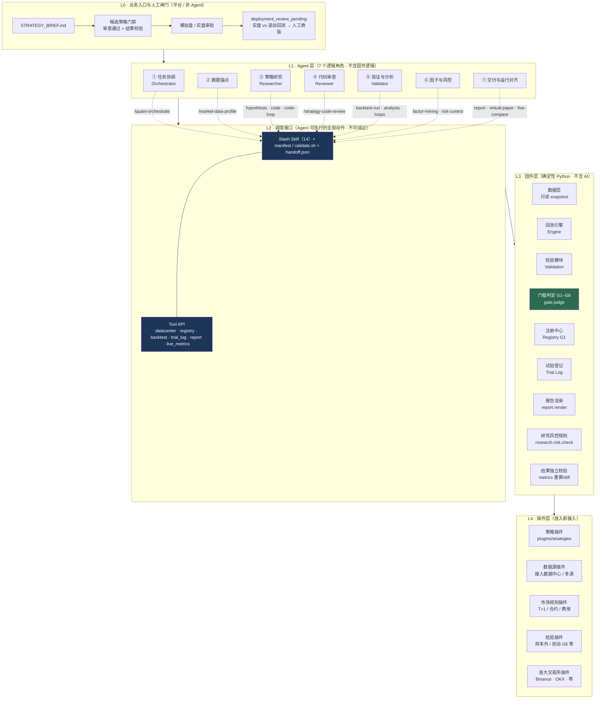
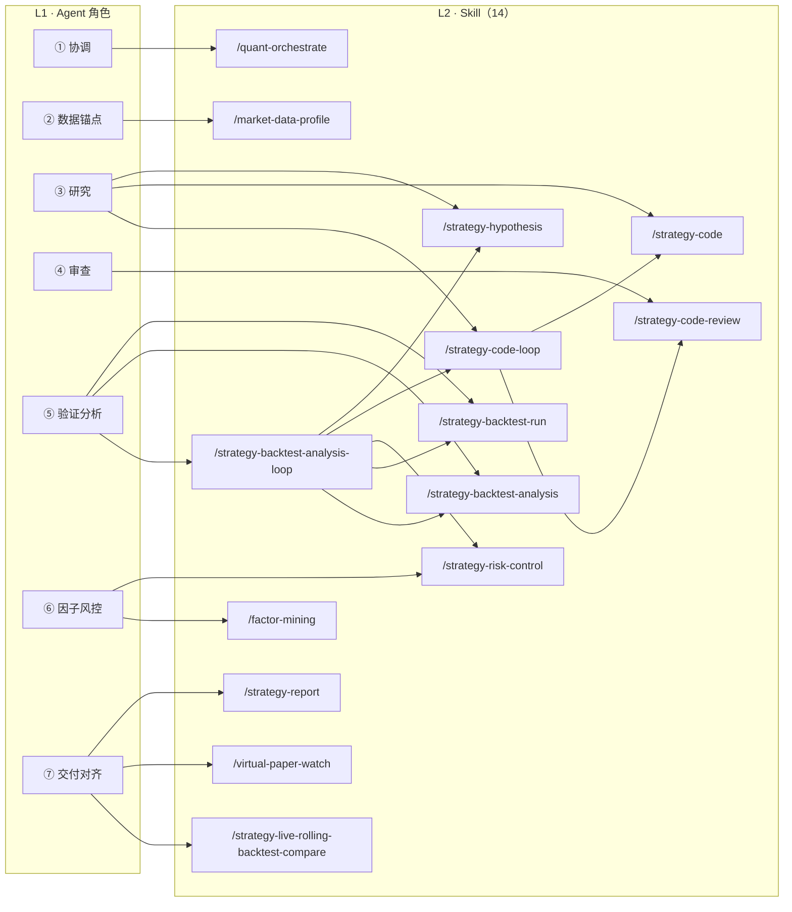
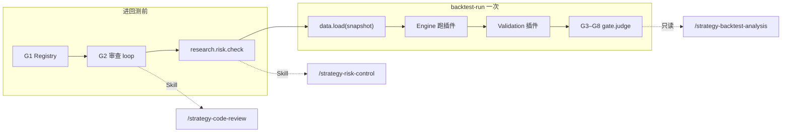
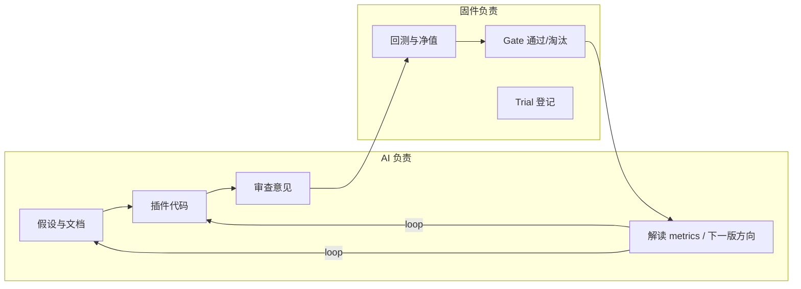

# 量化策略工厂 — 层次架构（固件 + 插件 + 多 Agent）

> **定位：** 与《量化研究平台架构设计：固件 + 插件 + 多 Agent 协作》及 Agent/Skill 文档对齐的可视化总图。  
> **原则：** Agent **只** 通过 **Skill 契约 + Tool API** 驱动系统；回测、门槛、指标 **不由 LLM 计算或签字**。

**关联文档：** [`quant-platform-skills-and-agents.md`](./quant-platform-skills-and-agents.md) · [`quant-platform-agents.md`](./quant-platform-agents.md) · [`quant-platform-agent-skill-map.md`](./quant-platform-agent-skill-map.md) · [`quant-ai-agent-vendor-requirements.md`](./quant-ai-agent-vendor-requirements.md)

**G1–G8 门槛图（PNG）：** [`quant-platform-gates-g1-g8.png`](./quant-platform-gates-g1-g8.png)

---

## 1. 总览图（四层 + 人工闸门）



---

## 2. 与参考「策略工厂」图的对照

| 参考图块 | 本平台对应 | 补充说明 |
|----------|------------|----------|
| **协调 / 研究 / 审查 / 修复 / 验证** 五 Agent | **7 逻辑角色**：协调、数据锚点、研究、审查（异模型）、验证分析、因子与风控、交付与运行对齐 | 「修复」落在 **`/strategy-code-loop`** 与 **`/strategy-backtest-analysis-loop`**，不单独设 Repair Agent |
| **调度接口：Agent 全部动作、无法绕过** | **14 个 `/slash-command` Skill** + **`*.manifest.result.json`** + **`contracts/*.validate.sh`** + **Tool API** | Agent **禁止**直连存储、手改 `gate.json`、exec 策略代码 |
| **数据层 / 回测 / 验证 / 门槛 / 注册 / 试验登记 / 报告** | L3 固件全套；**G3–G8 仅 backtest-run 触发** | **门槛判定**对应参考图绿色块 **G1–G8** |
| **策略 / 数据源 / 市场规则 / 验证插件** | L4 四类插件；策略由 Agent 写入后经 **G1 Registry + G2 审查** 入库 | 采购要求 **≥2 类数据源接入** → 数据源插件 + 数据中心发布 |
| （参考图未画） | **L0 人工闸门**：候选门禁、模拟盘→实盘、live vs rolling 待部署 | 见 [`quant-ai-agent-vendor-requirements.md`](./quant-ai-agent-vendor-requirements.md) §2、§5、§6 |

---

## 3. Agent 层 ↔ Skill 层（L1 展开）



| Agent | Skill | 禁止 |
|-------|-------|------|
| ① 协调 | `/quant-orchestrate` | 不写插件、不改 Gate、不替裁判 |
| ② 数据锚点 | `/market-data-profile` | 不拉数、不换源、不跑回测 |
| ③ 研究 | hypothesis · code · **code-loop** | 不自审通过 G2 |
| ④ 审查 | code-review（**异模型**） | 不写码 |
| ⑤ 验证分析 | backtest-run · analysis · **analysis-loop** | 不推翻 gate.json |
| ⑥ 因子风控 | factor-mining（侧链）· risk-control | 不替代 G3–G8 |
| ⑦ 交付对齐 | report · virtual-paper · live-compare | **不自动部署/换版/下单** |

---

## 4. 调度接口（L2）— Tool API 与契约

**Agent 仅能调用下列能力（示意，与 `core/tool_api/` 对齐）：**

| 类别 | Tool / 固件入口 | 典型 Skill |
|------|-----------------|------------|
| 数据中心 | 目录、snapshot 元数据、`data.load` 触发 | market-data-profile、backtest-run |
| 插件生命周期 | Registry 提交、G1 静态检查 | code → code-loop |
| 回测与检验 | `engine.run`、`validation.validate` | backtest-run |
| 门槛 | **`gate.judge` → gate.json** | backtest-run（写）· analysis（只读） |
| 试验索引 | `trial_log.query` / append | hypothesis、orchestrate |
| 报告 | `report.render`（可选） | strategy-report |
| 上线观测 | 虚拟盘指标、实盘 vs 滚动回测序列 | virtual-paper-watch、live-compare |
| 采购校验 | 指标 **独立重算/diff** 脚本 | 平台 UI，非 Skill 自证 |

**每一步交付：** `SKILL.md` + `contracts/<name>.manifest.desc` + `validate.sh` + 标准路径（如 `runs/.../trials/<trial_id>/`）。

---

## 5. 固件层（L3）— 门槛与数据流



| 固件模块 | 职责 | AI 是否可替代 |
|----------|------|----------------|
| 数据层 | 只读 **dataset_id + snapshot_id** | 否 |
| 回测引擎 | 加载已通过 Registry 的插件版本 | 否 |
| 检验模块 | 样本外、扰动等（G6） | 否 |
| **门槛判定 G1–G8** | 通过/淘汰 **唯一裁判** | **否** |
| 注册中心 | 插件名、family、version | 否 |
| 试验登记 | trial 索引、G8 族上限 | 否（Agent 只查询/触发登记） |
| 报告 | HTML/PDF 模板 | 否（Agent 写 MD 汇总） |
| 结果校验 | 对原始回测输出重算 | 否（采购 §2） |

---

## 6. 插件层（L4）— 放入即接入

| 插件类型 | 挂载点 | Agent 关系 |
|----------|--------|------------|
| **策略插件** | `plugins/strategies/<name>_v*.py` | **研究 Agent 编写** → Registry → Engine 加载 |
| **数据源插件** | 数据中心接入 / 镜像 | **数据工程**维护；Agent 只 **绑定** snapshot |
| **市场规则插件** | 涨跌停、合约乘数、费率 | 固件 Engine 读取；Brief `forbidden` 对齐 |
| **检验插件** | validation 扩展 | 固件 validate；Agent 不手改结果 |
| **各大交易所插件** | 各所 REST/WebSocket 适配 | **固件/后端**加载；Agent **不**直连下单；L0 审批后接模拟盘/实盘 |

---

## 7. 主链在层次上的穿越（挖掘一条策略）

```text
L0  STRATEGY_BRIEF.md
      ↓
L1  ② market-data-profile → ③ hypothesis → ① orchestrate
      ↓
L2  /strategy-code-loop → /strategy-risk-control → /strategy-backtest-run → /strategy-backtest-analysis
      ↓
L3  G1/G2（经 L2）→ risk.check → Engine + Validation + gate.judge
      ↓
L4  策略插件 + 数据 snapshot + 规则/检验插件
      ↓
L1  ⑦ strategy-report
      ↓
L0  人工：候选门禁 → 模拟盘 → 实盘 →（可选）live-rolling-compare → 人工换版
```

**外环：** analysis 不达标 → **`/strategy-backtest-analysis-loop`**（L2 再编排 L1 多角色，仍只经 Tool API 触 L3）。

---

## 8. 生成 vs 执行（横切原则）



---

## 9. 文档维护

| 变更类型 | 更新 |
|----------|------|
| 增删 Skill / Agent | 本文 §1–§3 + [`quant-platform-skills-and-agents.md`](./quant-platform-skills-and-agents.md) |
| Tool API / Gate | 本文 §4–§5 + [`quant-platform-agents.md`](./quant-platform-agents.md) |
| 验收与上盘 | 本文 L0 + [`quant-ai-agent-vendor-requirements.md`](./quant-ai-agent-vendor-requirements.md) |

---

*版本：v1 · 2026-10-29*
